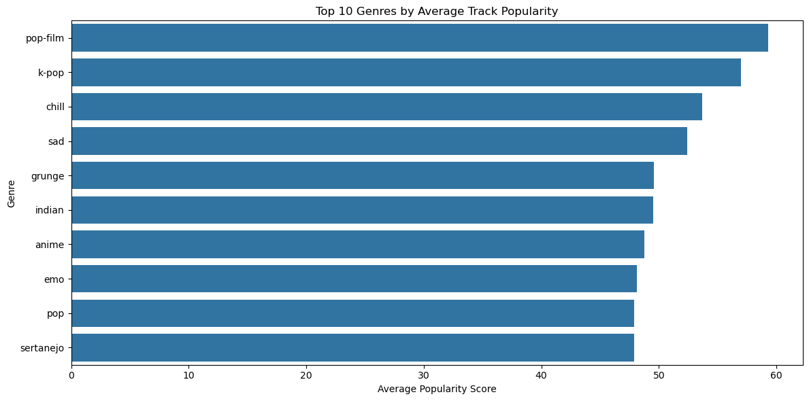
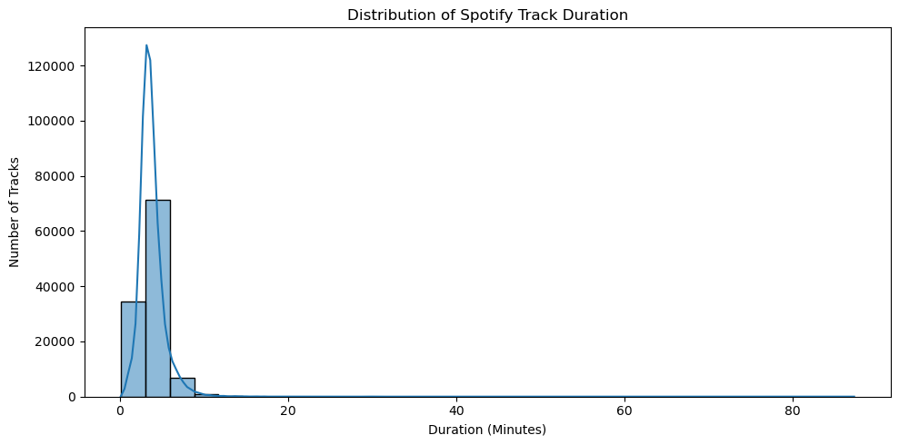
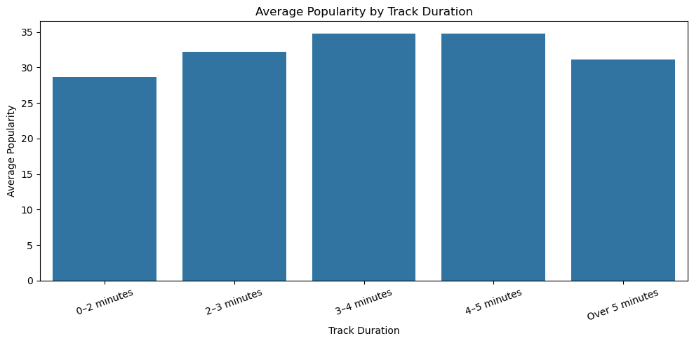
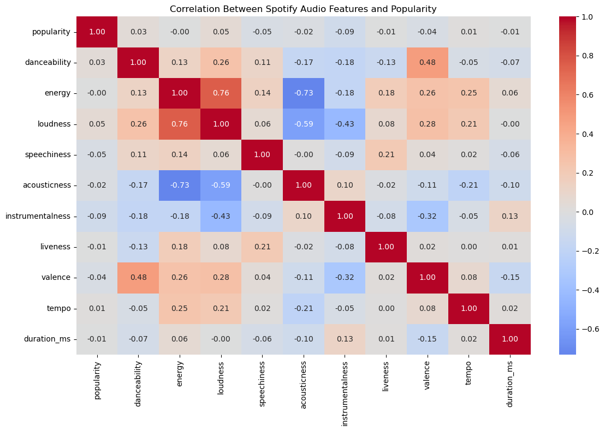
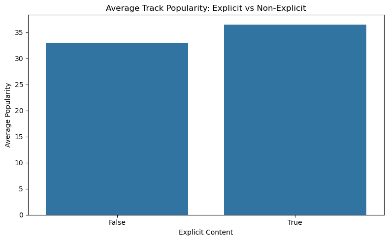
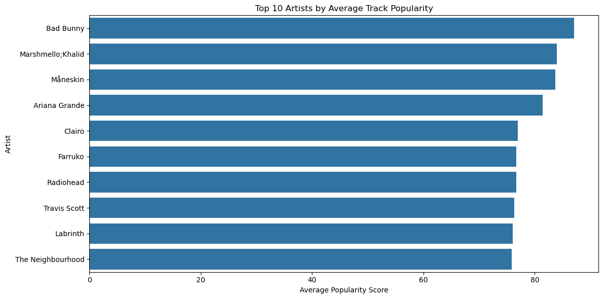
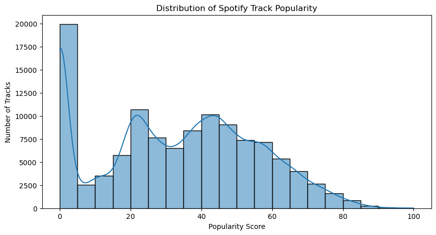
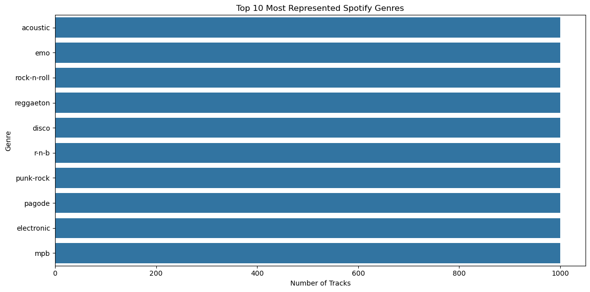

<div align="center">

# 🎧 Spotify Tracks Analysis

### Exploring music popularity, genre trends, and audio characteristics with Python


*A data analytics project turning Spotify track metadata into clear, business-focused insights.*

</div>

---

## 📌 Project Overview

Music streaming platforms work with large catalogs of tracks across genres, artists, and audio styles. This project explores a Spotify tracks dataset to understand how track popularity varies by **genre, duration, explicit-content label, artist, and audio features**.

The notebook follows an end-to-end exploratory data analysis (EDA) workflow: data inspection, data-quality checks, cleaning, visualization, business interpretation, and recommendations.

## 🎯 Business Objective

Identify useful patterns in track popularity that could inform music discovery, playlist curation, and catalog analysis. The findings are descriptive: they highlight associations in this dataset and **do not prove that any feature causes a track to become popular**.

## 📊 Dataset at a Glance

| Metric | Value |
|---|---:|
| Initial records | 114,000 |
| Columns initially available | 21 |
| Records after removing the invalid zero-duration row | 113,999 |
| Columns after removing the exported index column | 20 |
| Unique track IDs | 89,741 |
| Genres represented | 114 |
| Audio / track attributes | Popularity, duration, danceability, energy, loudness, acousticness, instrumentalness, tempo, and more |

**Data quality work performed**

- Removed one invalid record with zero duration and missing track-identifying fields.
- Removed the unnecessary exported index column and standardized whitespace in text fields.
- Identified and removed exact duplicate rows.
- Investigated repeated track IDs and retained legitimate multi-genre entries rather than treating every repeated ID as an error.
- Converted track duration from milliseconds to minutes for easier interpretation.

> **Dataset note:** The notebook uses a local CSV file. Add the dataset source and license to your repository before publishing the data itself.

---

## 🔍 Key Findings

<details open>
<summary><strong>1. Pop-film and K-pop lead average track popularity</strong></summary>

| Genre | Average popularity |
|---|---:|
| Pop-film | **59.28** |
| K-pop | **56.96** |
| Chill | 53.70 |
| Sad | 52.38 |



**Business takeaway:** These genres are worth investigating for playlist and discovery strategies. Genre-level averages should be considered alongside listener engagement, sample composition, and other signals.
</details>

<details open>
<summary><strong>2. Most tracks fall in the 2–5 minute range</strong></summary>



The average track duration is approximately **3.80 minutes**, while the median is approximately **3.55 minutes**.



Tracks in the **3–5 minute range** have the highest average popularity in the duration groups (around **34.75**). Tracks shorter than 2 minutes average **28.62**, while tracks over 5 minutes average **31.16**.

**Business takeaway:** Duration may be a useful descriptive attribute, but it should not be treated as a standalone rule for track success.
</details>

<details open>
<summary><strong>3. Audio features have weak linear relationships with popularity</strong></summary>



| Audio feature | Correlation with popularity |
|---|---:|
| Loudness | +0.047 |
| Danceability | +0.034 |
| Tempo | +0.012 |
| Instrumentalness | −0.095 |
| Speechiness | −0.045 |

Loudness has the strongest positive correlation in the analysis, but the relationship is extremely weak. Instrumentalness has the strongest negative correlation, also weak.

**Business takeaway:** Audio characteristics alone are unlikely to explain popularity. Artist recognition, playlist placement, release timing, genre, and listener preferences may also matter, but these factors were not established as causes by this analysis.
</details>

<details open>
<summary><strong>4. Explicit tracks have a higher average popularity score in this dataset</strong></summary>



| Track label | Average popularity | Median popularity | Records |
|---|---:|---:|---:|
| Explicit | **36.52** | 37.5 | 9,718 |
| Non-explicit | 33.02 | 34.0 | 103,831 |

**Business takeaway:** The observed difference is worth exploring by genre and audience segment. The dataset has many more non-explicit tracks, and this result does not mean explicit content causes higher popularity.
</details>

<details open>
<summary><strong>5. Artist popularity varies substantially</strong></summary>



Artists were ranked by average track popularity after applying a minimum threshold of **10 tracks** to reduce rankings driven by very small samples. In this analysis, Bad Bunny has an average popularity score of **87.08** across 48 tracks.

**Business takeaway:** Artist-level summaries can help identify high-performing catalog segments, but comparisons should account for track counts, genre, and release context.
</details>

---

## 📈 Additional Exploratory Visuals

### Track popularity distribution



### Genre representation



The notebook's ten most represented genres each contain **1,000 records**, reflecting balanced counts among those genres in this dataset.

---

## 💡 Business Recommendations

1. **Explore genre-level performance:** Investigate why Pop-film and K-pop show higher average popularity and test genre-aware discovery approaches against engagement metrics.
2. **Use multiple signals for recommendations:** Combine metadata, genre, artist, listening behavior, and playlist context instead of relying on one audio feature.
3. **Treat duration as context, not a rule:** Use the observed 3–5 minute pattern as a hypothesis to test, not as a guarantee of success.
4. **Segment explicit-content analysis:** Compare results across genres and audience groups before drawing product or playlist conclusions.
5. **Validate against engagement outcomes:** Where available, analyze streams over time, saves, skips, playlist additions, and repeat listening to better understand listener response.

## 🧰 Tools & Technologies

- **Python** — analysis workflow
- **Pandas & NumPy** — data manipulation and numerical analysis
- **Matplotlib & Seaborn** — charts and statistical visualizations
- **Jupyter Notebook** — analysis and documentation

## 🗂️ Project Structure

```text
spotify-tracks-analysis/
├── Spotify_Tracks_Analysis(2).ipynb
├── README.md
└── assets/
    ├── popularity_distribution.png
    ├── track_duration_distribution.png
    ├── genre_distribution.png
    ├── top_genres_by_popularity.png
    ├── audio_feature_correlation_heatmap.png
    ├── explicit_vs_non_explicit.png
    ├── popularity_by_duration.png
    └── top_artists_by_popularity.png
```

## ▶️ Run the Analysis

1. Install the required libraries:

   ```bash
   pip install pandas numpy matplotlib seaborn jupyter
   ```

2. Place the dataset CSV in the expected location and confirm the file path in the notebook.
3. Open `Spotify_Tracks_Analysis(2).ipynb` in Jupyter Notebook or JupyterLab.
4. Run the cells in order to reproduce the data checks, analysis, and visualizations.

## ⚠️ Limitations

- Findings reflect this dataset and may not represent all Spotify tracks or listener preferences.
- Popularity scores should not be interpreted as lifetime streams or a direct measure of user satisfaction.
- Correlation does not imply causation; most individual audio features have very weak linear correlations with popularity.
- Genre and artist comparisons may be influenced by catalog composition and the number of observations available.
- The analysis is exploratory and does not establish causal effects or evaluate a deployed recommendation system.

## 🚀 Future Improvements

- Build an interactive dashboard to explore genre, artist, and audio-feature patterns.
- Test a machine-learning baseline for popularity estimation with appropriate validation.
- Add time-based streaming and listener-engagement data if available.
- Develop and evaluate a recommendation approach using user preferences and track attributes.

## ✅ Conclusion

This project demonstrates a complete exploratory data analysis workflow—from data-quality checks and cleaning to visualization and business recommendations. The analysis identifies genre and duration differences in average popularity, highlights artist-level variation, and shows that individual audio features have only weak linear relationships with popularity.

---

<div align="center">

**Skills demonstrated:** Data Cleaning · Exploratory Data Analysis · Data Visualization · Statistical Interpretation · Business Insights

</div>
